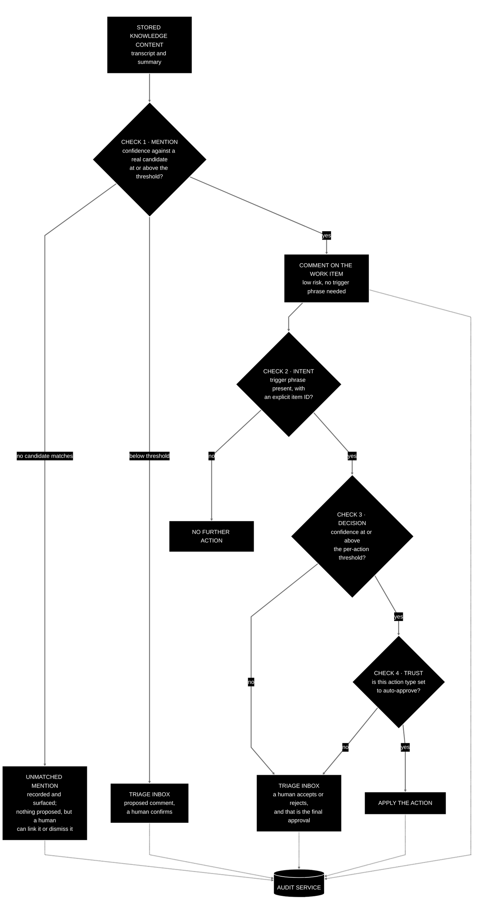

[← Back to the CKA PRD](../../README.md) · Previous: [8. Architecture](08-architecture.md)

## 9. Trust, safety and audit

### 9.1 The gate model

Two generic terms are used throughout. An **action check** is a single check in this chain — mention, intent, decision, trust. An **action threshold** is the value a confidence score is compared against at an action check. The four checks:

- **Check 1 — mention.** The decision provider's confidence that a candidate work item was mentioned, compared against the mention threshold (default 90%). Three outcomes, and no fourth: at or above the threshold, CKA comments on the item automatically — a comment changes nothing, so no trigger phrase and no approval are required; below the threshold, the comment is **proposed in the Triage Inbox** for a human to confirm rather than discarded; and where the reference matches no candidate in the pool at all, it is recorded as an **unmatched mention**.
- **Check 2 — intent.** The team trigger phrase is present and names the item by its ID in the same sentence. Only segments passing this check are ever considered for mutating actions.
- **Check 3 — decision.** The decision provider's confidence that the requested action is what was asked is at or above the per-action-type threshold.
- **Check 4 — trust.** The action type's trust setting is auto-approve; otherwise the proposal goes to the Triage Inbox.

**What the Triage Inbox holds.** Two different kinds of proposal, which look similar and mean very different things. A **proposed comment** is a low-confidence mention: CKA thinks an item may have been discussed but is not sure enough to say so on the item itself. Accepting it posts a comment; rejecting it posts nothing. A **proposed action** is a mutating change — close, transition, assign — and always carries more weight. Both are shown with their confidence, the excerpt they came from, and the provider and model that produced them, so the two are distinguishable at a glance.

**Unmatched mentions.** Check 1 classifies against the pool of *real* candidate work items, so a reference that corresponds to nothing in the pool cannot produce an action. Rather than disappearing, it is recorded as an **unmatched mention**: written to the action decision chain and shown in the front end as its own state, not as a triage proposal — there is nothing for a human to accept, because CKA found no item to attach the acceptance to. This is deliberately distinct from both a low-confidence mention, which *does* have a candidate and therefore can be proposed, and a rejected proposal, which was a real — if wrong — match that a human turned down. The three say, in order: "something was said that we could not tie to any work item"; "we think this item was discussed, but we would like you to confirm"; and "we tied it to an item, and the human disagreed". All three are visible; none is silently dropped.

**An unmatched mention can be resolved, which is not the same as accepting one.** There is still nothing to *accept* — no candidate was matched, so there is no proposal and no confidence score to weigh. But a person reading one usually knows what it meant, and that knowledge is the most useful thing in the system about CKA's own accuracy. So an unmatched mention carries two resolutions: **link it** to the work item it actually referred to, which posts the comment that would have been posted had detection found it; or **dismiss it**, saying there was nothing there — a mistranscription, or talk that was never about a work item at all. Leaving it alone is a third, valid outcome: unresolved is the state it starts in and may stay in. Both resolutions are recorded in the action decision chain with the person who made them, and both feed [9.2](#92-trust-scores-and-calibration). Linking is deliberately not a free-text correction: it names an existing work item, so the record stays comparable across mentions.

**A human accept in the Triage Inbox is the final approval.** There is no second confirmation dialog after it. One clear approval point, deliberately, rather than a habit-forming double prompt that trains people to click through.

### 9.2 Trust scores and calibration

CKA learns from one thing only: decisions a human actually made. Two different kinds of learning come out of that, and they change two different things. A **trust score** changes *who approves* an action type. **Calibration** changes *where the lines sit* — the thresholds the action checks compare against, and how well detection is working at all. Both only ever produce a suggestion.

**Trust scores.**

- Per action type (comment, transition, close, assign, ...), never global. A reasonable global default set exists; each type is individually configurable with minimal effort.
- Proposed defaults: comment — automatic; transition, close, assign — review.
- Computed from human approve/reject decisions over a configurable window. Drives both the "switch to auto-approve" suggestion and the "disable, or switch provider" suggestion.

**Calibration.** Check 1's mention threshold ships at a default (90%) that nobody can set correctly in advance, because the right value depends on a team's vocabulary, how its items are named and how its meetings run. Every decision a person makes in the Triage Inbox is evidence about that value, and until now CKA recorded those decisions and learned nothing from them. Three inputs, which [T23](mvp-tickets.md#t23-calibration-learning-from-mention-decisions) computes over the same configurable window as the trust scores:

- **Accept and reject on proposed comments**, bucketed by the confidence each was proposed at. This is the signal with a number attached, and it answers a specific question: is the threshold leaving work on the table? If every proposal above some confidence has been accepted, the threshold is above where this team's judgement actually sits, and CKA says so with the value it would move to — *"You've accepted all 23 mention proposals scoring 70% or above over the last two weeks. Lower the mention threshold from 90% to 70%?"* Accepting the suggestion means those comments post automatically in future instead of waiting in triage.
- **Rejects within a band**, which are the same evidence pointing the other way: a band of confidences a team keeps rejecting is noise being manufactured at a cost, and raising the threshold past it stops CKA proposing in that band at all.
- **Resolutions on unmatched mentions.** A link says CKA missed something a person could see; a dismissal says there was nothing to find. The ratio is a measure of detection quality rather than of any threshold, and it drives the suggestion the trust ramp already makes for a different reason — *"9 of the 11 unmatched mentions you resolved in the last two weeks turned out to be real work items. Try a different decision provider or model?"* Once candidate pool scoping exists ([7.5](07-core-concepts-and-domain-model.md#75-candidate-pool)), the same data answers a second question — whether the pool is too narrow — by distinguishing items that were in the pool and missed from items that were never in it. In the MVP the pool is every issue in the repository, so every link is a miss, and only the first reading applies.

**Three rules keep this honest, and they matter more than the arithmetic:**

- **It only ever suggests. A threshold never moves on its own.** A threshold that lowered itself using proposals its own previous value produced would be grading its own homework, and each move would widen the band of evidence justifying the next. The human in the loop is what breaks that loop, and it is the same human who approves actions — so the mechanism needs no new trust model, just the existing one applied to a setting instead of an action.
- **A minimum number of decisions before anything is suggested**, configurable, defaulting to a value set when T23 is scoped. "You've accepted 100%" of two proposals is not evidence of anything, and a suggestion made on it teaches people to ignore the banner — which costs more than the suggestion was ever worth.
- **The evidence is one-sided, and the suggestion says so.** Humans only ever see mentions that fell *below* the threshold; everything above it was commented on automatically and nobody reviewed it. So accept data can justify lowering the threshold toward the floor of the accepted band, but it can never justify raising it — there is no human verdict on the auto-commented side to raise it against. Rejects below the line are the only upward evidence there is. CKA does not pretend otherwise, and the banner states the window and the count it is arguing from so the reader can judge it.

### 9.3 Audit

- Every action — automatic or human-approved — is recorded with provider, model, confidence, decider, **the prompt version that produced the summary it came from**, and outcome.
- The unit of record is the **action decision chain** (see [7.8](07-core-concepts-and-domain-model.md#78-audit-record)): the full traceable path from the original captured content through knowledge storage, mention detection (unmatched mentions included), comments, proposals, the human accept or reject, and the applied action, to the outcome or error. Any applied or rejected action can be traced back to the recording it came from.
- Human decisions on **mention** detection are recorded the same way as decisions on actions: accept and reject on proposed comments, and link and dismiss on unmatched mentions, each with the person who decided. Without them the chain records what CKA proposed and not what anyone made of it, and [9.2](#92-trust-scores-and-calibration) has nothing to calibrate against.
- The audit trail is the basis for the trust ramp, calibration, the activity view and post-hoc investigation ("why did it close that?").
- It lives in the audit service, not in any third-party platform, so an unavailable knowledge or work item provider cannot take accountability down with it.

---

← Back to the PRD: [README](../../README.md) · Previous: [8. Architecture](08-architecture.md) · Next: [10. Extensibility](10-extensibility.md) →
